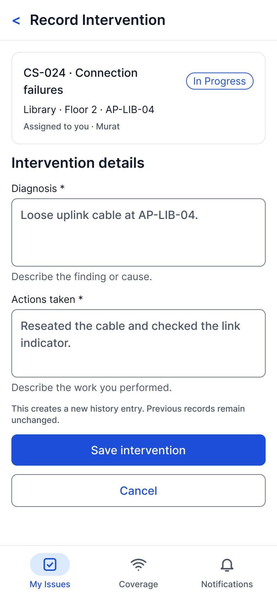
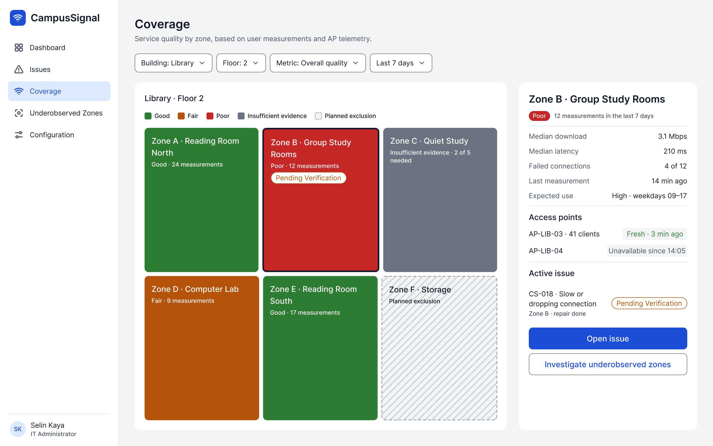
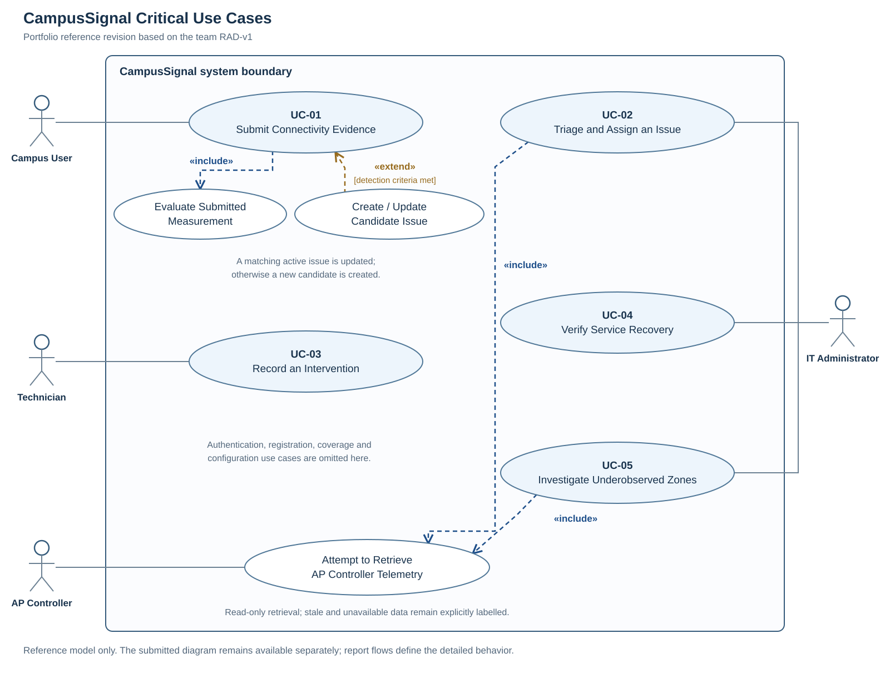

# CampusSignal

Requirements analysis and Figma UI prototyping for campus Wi-Fi issue reporting and service recovery. A six-person Object-Oriented Analysis and Design course project at Manisa Celal Bayar University, Fall 2026.

**Project stage:** RAD-v1 analysis and prototype snapshot dated 25 October 2026. The artifacts describe proposed behavior and illustrative screens; they do not demonstrate a deployed application, implemented backend, live AP integration or measured production performance.

## Explore the project

- [Read the public RAD-v1 report](docs/CampusSignal_RAD_v1_Public.pdf)
- [Open the Figma design file and screen catalogue](https://www.figma.com/design/nSv8Gq4lP7FpZDuJDeCeDG/CampusSignal?node-id=0-1)
- [Open the UC-05 prototype starting point](https://www.figma.com/proto/nSv8Gq4lP7FpZDuJDeCeDG/CampusSignal-%E2%80%93-RAD-v1-Prototype?node-id=21-215&starting-point-node-id=21%3A215)
- [View the prototype screen catalogue](prototype/README.md)
- [Read the publication and review notes](docs/publication-notes.md)

The Figma links are preserved from the project materials. Their current sharing settings and navigation have not been reverified as part of this publication package.

## Problem and proposed workflow

CampusSignal combines user-submitted connectivity evidence, read-only access-point telemetry and a managed issue workflow. It separates insufficient observations from confirmed poor service, and separates a technician's recorded intervention from verified recovery.

| Critical use case | Primary role | Purpose |
| --- | --- | --- |
| UC-01 Submit Connectivity Evidence | Campus User | Submit measurements or failed-connection evidence, including an offline-queue alternative |
| UC-02 Triage and Assign an Issue | IT Administrator | Review evidence, record approval or rejection, and assign a technician |
| UC-03 Record an Intervention | Technician | Record diagnosis and actions, then request verification |
| UC-04 Verify Service Recovery | IT Administrator | Close, reopen or retain an issue pending sufficient fresh evidence |
| UC-05 Investigate Underobserved Zones | IT Administrator | Request targeted measurements and record a justified investigation outcome |

The RAD documents **59 functional requirements, 24 nonfunctional requirements, five scenarios and five detailed critical use cases**, with traceability to screen identifiers. Quantitative availability, timing and load values are acceptance targets rather than measured results.

## My documented contribution

**Devran Deniz Akgül:** UC-03 scenario and textual use-case description; FR-20 to FR-29; the glossary; contributions to the UI-20 to UI-29 technician screen set and navigation terminology. This work covers diagnosis/action recording, validation and recovery states, and the request-verification handoff. See Annex I in the report for the team attribution.

## Team

| Team member | Documented primary responsibility |
| --- | --- |
| Eren Öztürk | Introduction, UC-01, FR-01 to FR-09 and supporting FR-50 to FR-59 |
| Efe Özdemir | Current System, UC-02, FR-10 to FR-19 and the submitted use-case diagram |
| Arda Korkmaz | NFR-01 to NFR-24, shared Figma components, integration and report assembly |
| Azize Görür | UC-04, FR-30 to FR-39, traceability and issue-state consistency |
| Caner Gündaş | UC-05, FR-40 to FR-49, functional-requirement consolidation and appendix coordination |
| Devran Deniz Akgül | UC-03, FR-20 to FR-29, glossary and technician screens |

## Selected artifacts

### Technician intervention form

### Coverage heatmap

### Critical use cases reference

This focused portfolio reference corrects relationship directions and connects the candidate-issue extension. It is separate from the diagram in the submitted report and is not its recovered original editable source. [Diagram provenance and source](diagrams/README.md).

## Known scope and limitations

- This snapshot is RAD-v1. Object, sequence and state-machine models are reserved for RAD-v2.
- The report records incomplete UC-04 click reactions for UI-30, UI-32, UI-33 and UI-34; a complete interactive recovery flow is not certified.
- A dedicated Reopened-to-In-Progress resume route and complete regression testing are not verified in this snapshot.
- Screen values, records and telemetry are illustrative. Persistence, integrations, consent enforcement and performance require implementation and testing.

The public report removes student numbers and unconfirmed internal meeting drafts. Original printed page labels are retained. See the publication notes for the exact preparation scope.
